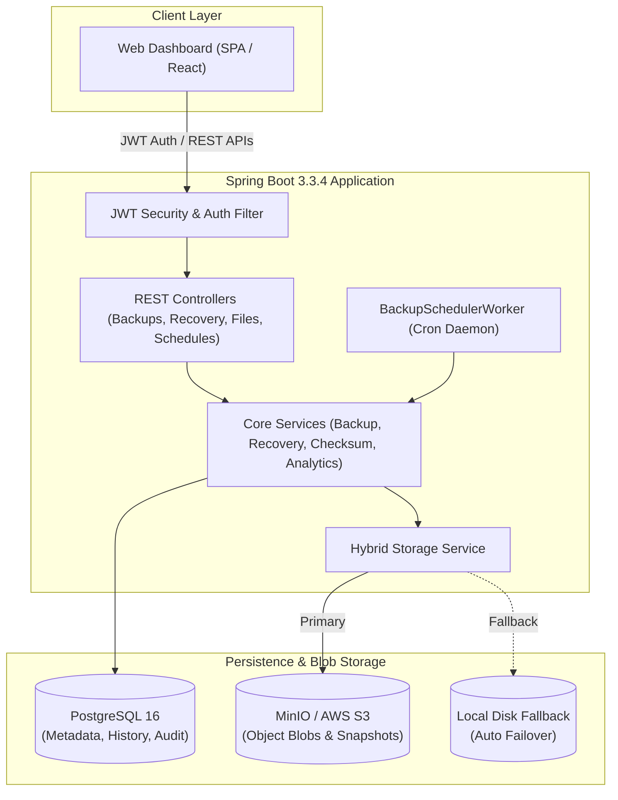

# CloudBackup Enterprise System

An enterprise-grade, high-reliability Cloud Backup and Disaster Recovery platform featuring multi-version file snapshotting, cryptographic SHA-256 integrity verification, automated cron scheduling, and real-time operational analytics.

---

## 🏗️ Architecture Overview



---

## 🌟 Key Features

1. **Cryptographic SHA-256 Integrity Verification**
   - Ingested snapshot blobs are immutably signed using SHA-256.
   - Pre-flight verification recalculates the hash before disaster recovery restoration.
   - Detects bit rot, tampering, and silent data corruption, flagging corrupted versions as `CORRUPTED`.

2. **Automated Versioning Engine**
   - Point-in-time snapshotting with automatic sequential version numbers (`v1`, `v2`, `v3`...).
   - Unique storage keys partitioned by user and file IDs.
   - Preserves historical versions while allowing fast instant rollbacks.

3. **Background Scheduling Worker**
   - Recurring backup automation supporting Daily, Weekly, Monthly, or Custom 6-part Cron expressions.
   - Autonomous background scheduler worker scans and triggers due snapshots without human intervention.

4. **Multi-Tier Resilient Storage**
   - Native integration with MinIO / Amazon S3 object storage.
   - Embedded `LocalStorageService` graceful fallback for local development or disconnected offline environments.

5. **Quota & File Governance**
   - Per-user storage quota enforcement (10 GB default).
   - Real-time quota calculation, soft deletion, and undelete capabilities.
   - Strict directory traversal protection preventing malicious path escape attempts.

6. **Full-Featured Modern Web Console**
   - Live KPI dashboard with 7-day activity volume charts.
   - File manager with drag-and-drop uploads.
   - Version catalog with live cryptographic hash inspection and 1-click restoration.
   - In-app notification center.

---

## 🚀 Quick Start Guide

### Option 1: Docker Compose (Full Stack)

Ensure Docker is installed, then launch the entire stack (PostgreSQL, MinIO, Backend, and Frontend):

```bash
docker-compose up --build -d
```

- **Frontend Web Dashboard**: http://localhost:3000
- **Spring Boot Backend REST API**: http://localhost:8080/api
- **MinIO S3 Console**: http://localhost:9001 (User: `minioadmin`, Password: `minioadminpassword`)

---

### Option 2: Running Backend & Frontend Locally

#### 1. Start the Spring Boot Backend

```bash
cd backend
mvn spring-boot:run
```

The backend starts on `http://localhost:8080`. By default, it runs with local storage fallback enabled if MinIO is not running.

#### 2. Open the Web Dashboard

The frontend includes a zero-build client that works directly:

```bash
cd frontend
python3 -m http.server 3000
```

Open `http://localhost:3000` in any web browser.

**Demo Credentials**:
- **Email**: `admin@cloud.io`
- **Password**: `Password123!`
*(Or click "Register" to create a new user account with a fresh 10 GB quota)*

---

## 📡 REST API Reference

| Method | Endpoint | Description |
|---|---|---|
| `POST` | `/api/auth/register` | Register new user account with default 10 GB quota |
| `POST` | `/api/auth/login` | Authenticate user and receive JWT Bearer token |
| `GET` | `/api/auth/me` | Fetch authenticated user profile & storage quota status |
| `POST` | `/api/files/upload` | Upload files with folder path & quota verification |
| `GET` | `/api/files` | List/search active files by name or folder |
| `DELETE` | `/api/files/{id}` | Soft-delete file & release user storage quota |
| `POST` | `/api/files/{id}/restore` | Undelete soft-deleted file |
| `POST` | `/api/backups` | Create manual backup snapshot for selected files |
| `GET` | `/api/backups` | List backup snapshots with status and size |
| `GET` | `/api/backups/{id}` | Get backup snapshot details including all versions |
| `DELETE` | `/api/backups/{id}` | Purge backup snapshot and cloud storage blobs |
| `GET` | `/api/versions/{fileId}` | Retrieve all historical versions for a file |
| `GET` | `/api/versions/{versionId}/download` | Stream and download version blob from storage |
| `POST` | `/api/recovery/verify-integrity/{id}` | Run live SHA-256 cryptographic check against blob |
| `POST` | `/api/recovery/restore-version/{id}` | Verify hash and restore snapshot to destination path |
| `POST` | `/api/recovery/batch` | Batch disaster recovery for multiple version snapshots |
| `GET` | `/api/recovery/history` | Audit trail of all recovery events and diagnostics |
| `POST` | `/api/schedules` | Configure automated recurring backup schedule |
| `GET` | `/api/schedules` | List active user backup schedules |
| `PATCH` | `/api/schedules/{id}/toggle` | Pause or activate automated schedule |
| `POST` | `/api/schedules/{id}/trigger-now` | On-demand immediate execution of scheduled job |
| `DELETE` | `/api/schedules/{id}` | Remove backup schedule |
| `GET` | `/api/notifications` | Fetch user alerts and execution notifications |
| `PATCH` | `/api/notifications/{id}/read` | Mark individual notification as read |
| `POST` | `/api/notifications/read-all` | Mark all notifications as read |
| `GET` | `/api/analytics/dashboard` | KPI metrics (files, quota %, pass rates, automations) |
| `GET` | `/api/analytics/activity` | 7-day daily activity trend data points |

---

## 🧪 Automated Testing

Unit and integration test suites cover all core operational aspects:

```bash
cd backend
mvn test
```

### Test Coverage Highlights
- `ChecksumServiceTest`: Validates deterministic SHA-256 calculation and stream tampering detection.
- `AuthServiceTest`: Tests user onboarding, password hashing, token generation, and duplicate email prevention.
- `FileServiceTest`: Tests quota boundary limits, upload validation, and path traversal security.
- `BackupServiceTest`: Tests snapshot generation, version incrementing (`v1` → `v2`), and blob storage dispatch.
- `RecoveryServiceTest`: Tests integrity validation matching and corruption detection (`VersionStatus.CORRUPTED` and `IntegrityViolationException`).
- `AnalyticsServiceTest`: Verifies KPI metrics calculations and daily activity trends.
- `ScheduleServiceTest`: Validates cron syntax parsing, frequency resolution, and active toggling.

